## Larger than memory data

- Data in your laptop storage that you can't all load in your R or Python session
- Data on S3, GCS, or Azure Blob Storage
- Gigabytes

## {background-image="assets/three_layers.jpg"  background-size="900px"}

::: footer
Source: https://docs.google.com/presentation/d/19H7BV52OG6zgw3krpTMzq8OeN34-y85hIS0g1sw3Qbw/edit?usp=sharing
:::


## Small data fits in memory

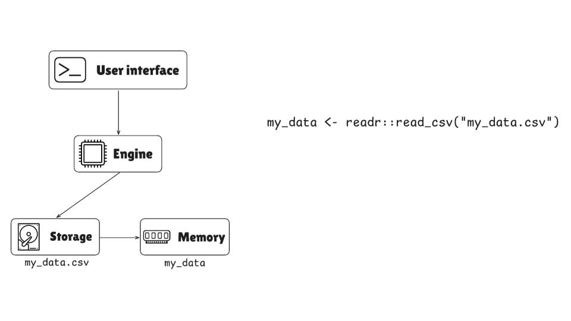


## ... and you use `dplyr` or `pandas` to analyze it

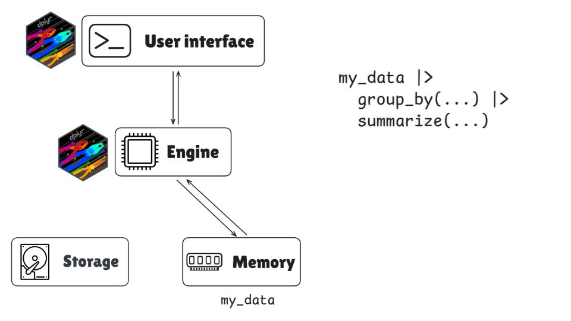


## Example: Iris Flower Data

```{r}
library(dplyr)

iris |>
  summarise(petal_len_mean = mean(Petal.Length), .by = Species)
```

## But when data is larger than memory you'd need a database

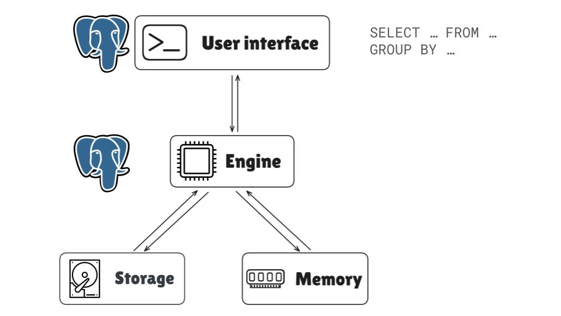


## `dplyr` lets you avoid writing SQL

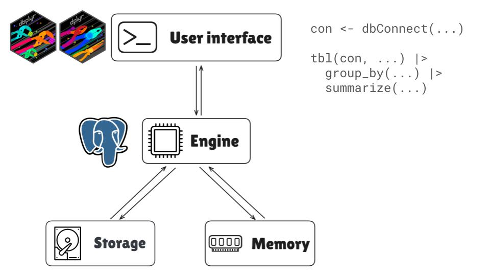


## But typical databases are slow

- Reading is slow because they are row-oriented
- Made for transactions rather than analytics

# Meet DuckDB

> An analytical SQL database that can run in-process.

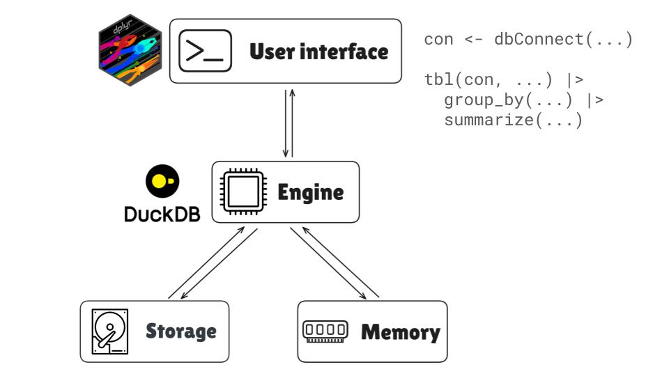

## DuckDB is column-oriented

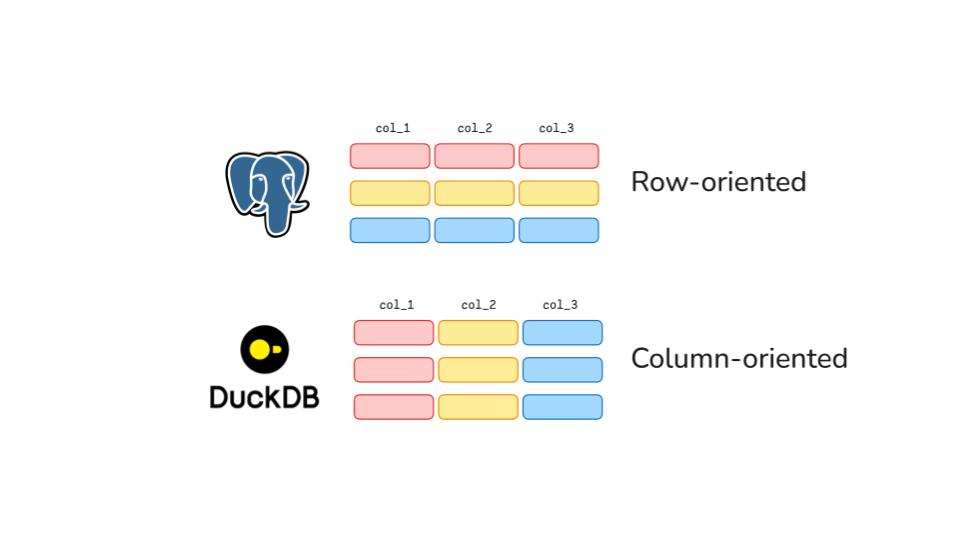

## DuckDB can read Parquet files

- Parquet is a column-oriented storage format
- Parquet understands the column types unlike CSV

## NYC Yellow Taxi Trip Files

Data are available [here](https://www.nyc.gov/site/tlc/about/tlc-trip-record-data.page)

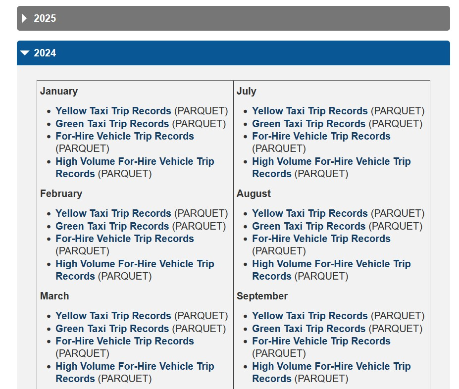


## NYC Yellow Taxi Trip Files

```{r}
#| eval: false
#| code-line-numbers: "1-2|3|4-5|6-9"
library(DBI)
library(duckdb)
con <- dbConnect(duckdb())
dbExecute(con, "INSTALL httpfs")
dbExecute(con, "LOAD httpfs")
dat_2021 <- dbGetQuery(
  con,
  "SELECT * FROM read_parquet('https://d37ci6vzurychx.cloudfront.net/trip-data/yellow_tripdata_2021-05.parquet')"
)
```

::: {.fragment}
```{r}
#| echo: false
arrow::open_dataset("data/parquet_files/pickup_year=2021/pickup_month=5/") |>
  head() |>
  dplyr::collect() |>
  print()
```
:::


## With a bit more work, you can save files for several years

Assuming you have all the parquet files in the `data/parquet_files` folder, you may use `arrow` and `dplyr` for wrangling and saving

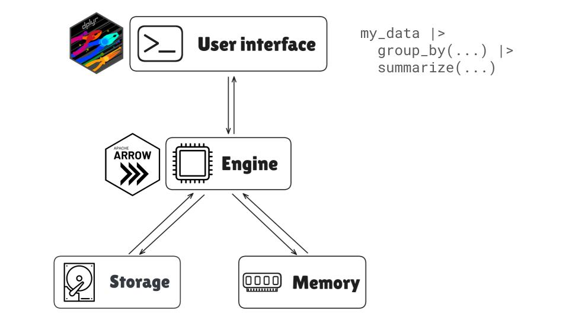


## {background-image="assets/partitioned.png" background-size="300px"}


## `arrow` is great for data exploration

```{r}
library(arrow)
library(tidyverse)
trips <- open_dataset("data/parquet_files", format = "parquet")
trips
```

## Example: Monthly amounts charged to passengers

```{r}
monthly_amounts <- trips |>
  summarize(amount = sum(total_amount), .by = c(pickup_year, pickup_month)) |>
  collect()

monthly_amounts |> head(3)
```

## Example: Plot

```{r}
#| eval: false
ggplot(
  monthly_amounts,
  aes(pickup_month, amount, color = as.character(pickup_year))
) +
  geom_line()
```

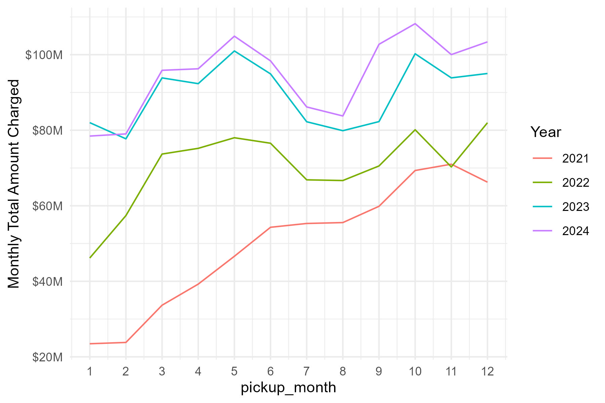


## Create new database tables 

```{r}
#| eval: false
#| code-line-numbers: "1-2|3-6|7"
library(DBI)
library(duckdb)
con <- dbConnect(
  duckdb::duckdb(),
  dbdir = "data/taxi.duckdb",
)
dbListTables(con)
```

::: {.fragment}
```
character(0)
```
:::

## Create new database tables 

```{r}
#| eval: false
#| code-line-numbers: "1-5|6|7|10|11-12|13-16|17|18-19|25"
src <- "read_parquet(
  'data/parquet_files/**/*.parquet',
  hive_partitioning = true,
  union_by_name = true
)"
dbExecute(
  con,
  sprintf(
    "
  CREATE OR REPLACE TABLE trips_clean AS
  SELECT
    <select columns you want>,
    date_diff('minute', tpep_pickup_datetime, tpep_dropoff_datetime) AS trip_minutes,
    extract(hour  FROM tpep_pickup_datetime) AS pickup_hour,
    extract(dow   FROM tpep_pickup_datetime) AS pickup_dow,
    date_trunc('month', tpep_pickup_datetime) AS pickup_month_ts
  FROM %s
  WHERE passenger_count >= 1  AND passenger_count <= 6
    AND date_diff('minute', tpep_pickup_datetime, tpep_dropoff_datetime) BETWEEN 1 AND 180
",
    src
  )
)

dbListTables(con)
```

::: {.fragment}
```
"hourly"       "monthly"      "trips_clean"  "zone_pickups" "zones"
```
:::

## {background-image="assets/dbs.png" background-size="800px"}


## `ggsql` can visualize directly from the database

```{r}
#| eval: false
#| code-line-numbers: "1|2|3|4|5-8|11-17"
library(ggsql)
reader <- duckdb_reader("data/taxi.duckdb")
p1 <- ggsql_execute(
  reader,
  "
VISUALISE pickup_hour AS x, n_trips AS y FROM hourly
DRAW line
"
)

p2 <- ggsql_execute(
  reader,
  "
VISUALISE pickup_month AS x, mean_fare AS y, pickup_year AS color FROM monthly
DRAW point
"
)
```

##

::: {layout-ncol=2}

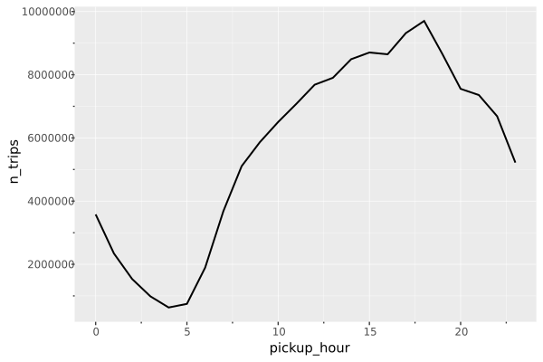

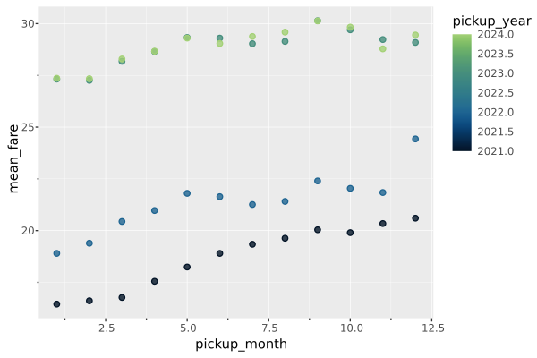

:::


## `orbital` can translate Python ML pipeline to SQL

```{python, python.reticulate=FALSE}
#| eval: false
#| code-line-numbers: "1|3-8|9|10-13|14"
import orbital

pipeline = Pipeline(
    [
        ("scaler", StandardScaler()),
        ("model", LinearRegression()),
    ]
)
pipeline.fit(train[FEATURES], train["total_amount"])
orbital_pipeline = orbital.parse_pipeline(
    pipeline,
    features={c: orbital.types.DoubleColumnType() for c in FEATURES},
)
sql = orbital.export_sql("trips_clean", orbital_pipeline, dialect="duckdb")
```


# Visualizing Geospatial Data

- Leaflet has been great but slows down with big data because it uses `GeoJSON`

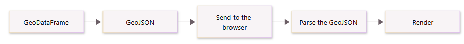

::: {.fragment}

- Lonboard uses geoparquet

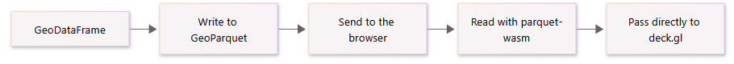

:::

::: footer
Source: https://ricochet.rs/blog/high-performance-spatial/
:::


## Example: Trip Flows

<iframe src="outputs/taxi_trips_explorer.html" width="100%" height="800px" style="border:none;"></iframe>


## Example: Trip Animation

<iframe src="outputs/taxi_day_animation.html" width="100%" height="800px" style="border:none;"></iframe>


# Questions?

Thanks for your time
- Relevant materials are on my GitHub: 